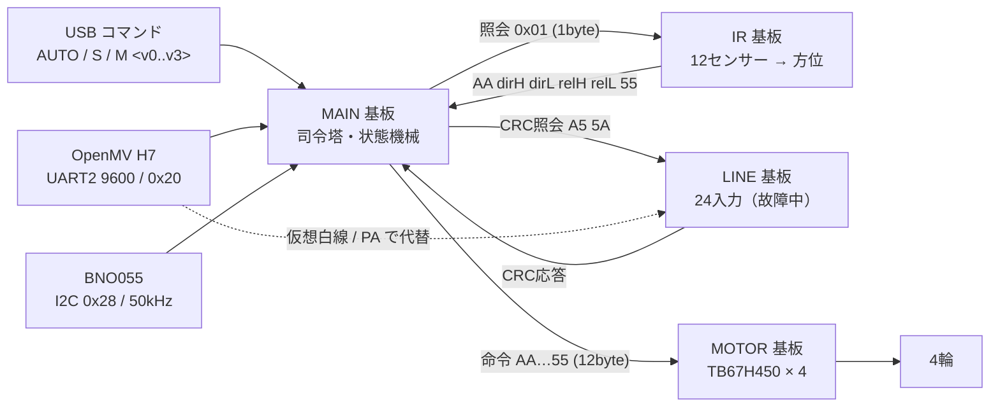
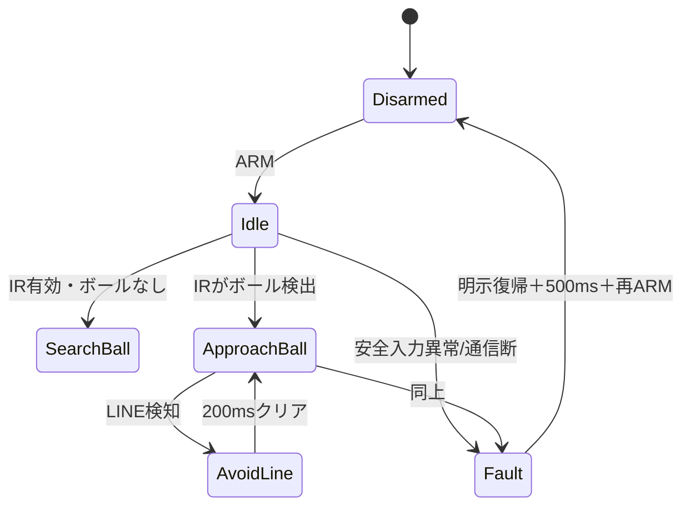

# サッカーロボットファームウェア 総まとめ（一目でわかる）

> [!IMPORTANT]
> **今、実際に動くのは `AUTO IR` の台上試験だけ**です。`AUTO FLOAT` / `AUTO FLOOR` は構成ゲートが閉じたまま起動できません。
> **停止手段は `S` コマンドと MOTOR 基板の物理電源スイッチのみ**（ソフトの300msウォッチドッグは削除済み）。
> 基準コミット：`c4fa5db`（直近2コミットはコメント日本語化のみ／挙動は `f3afba62` と同一）。

---

## 0. 30秒で理解する

| 見たいもの | 答え |
|---|---|
| **誰が指揮する？** | `main/main.ino` の MAIN 基板だけが RS485 の親（マスター） |
| **ボールは誰が見つける？** | IR 基板（12個の赤外線センサーで方位を推定） |
| **白線は誰が見つける？** | 現在は **OpenMV カメラ**が仮想白線を推定（実LINE基板は故障中） |
| **キックを決めるのは？** | **カメラのみ**（IR はボール回収専門。どちらのゴールか分からないため） |
| **ゴールはどっち？** | **黄色**（`TARGET_GOAL = "YELLOW"`） |
| **モーターはどう動く？** | MAIN が12byteフレームを送り、MOTOR が4輪の TB67H450 を PWM 駆動 |
| **ジャイロは何に使う？** | カメラがシュート判断した瞬間の方位を記憶し、ゴールが消えても直進する「方位ホールド」 |
| **何が未検証？** | RS485実配線、IR/LINE実測、BNO実機、車輪の合成方向、キッカー高圧回路 |

**データの流れ（これだけ覚えればOK）**

```text
IR(ボール方位) ─┐
LINE(故障)     ─┼─→ MAIN ── Motion{x,y,turn} ──→ MOTOR ──→ 4輪
カメラ(白線/ゴール)┤        ↑
BNO055(方位)  ─┘        └ 戦術状態機械が判断
USB(S / M / AUTO) ─────→ MAIN
```

---

## 1. 全体構成図



**RS485 は1本の共有バス。** MAIN が `Rs485MasterArbiter` で「一度に話す相手は1つだけ」を保証します。
基本順番は **IR → LINE → MOTOR**（約40ms周期）。AUTO IR では LINE を飛ばして **IR → MOTOR** です。

---

## 2. 4基板ひと覧

| 基板 | ファイル | センサー／周期 | 受け取るもの | 返す／出すもの |
|---|---|---|---|---|
| **MAIN** | `main/main.ino` | 制御5ms | USB・IR応答・LINE応答・BNO・カメラ | MOTOR命令12byte・GPIO11キック |
| **IR** | `ir/ir.ino` | GPIO18〜29 / 5ms | `0x01` 要求 | 方位＋相対信号（6byte） |
| **LINE** | `line/line.ino` | GPIO2〜25 / 20ms | CRC要求 | 白線状態（CRC応答）※聞かれた時だけ |
| **MOTOR** | `motor/motor.ino` | PWM 20kHz | 12byte命令 | 4輪 PWM／ブレーキ |

**故障マスク**：LINE の 1, 5, 8, 9, 11, 21 番を除外 → **18個で運用**。極性・角度は未確定。

---

## 3. 通信プロトコル早見表

| 種類 | バイト列 | 検査 | 備考 |
|---|---|---|---|
| IR要求 | `01` | なし | 共有バスのフレーム内 `01` は誤判定しない |
| IR応答 | `AA [方位H][方位L][強度H][強度L] 55` | 形式のみ | 方位0〜359／強度は相対値（cmではない） |
| LINE要求 | `A5 5A 01 03 00 [seq] [CRC_L][CRC_H]` | CRC16 | 種別 `03`=要求 |
| LINE応答 | `A5 5A 01 01 [len][seq][payload] [CRC_L][CRC_H]` | CRC16 | 種別 `01`=状態、連番管理 |
| MOTOR命令 | `AA 04 [v0L v0H] … [v3L v3H] [XOR] 55` | 値域・XOR・終端 | **ACKなし**／-255..255・`256`=ブレーキ |
| カメラ | `20 [vx][vy][turn][kick][mode][flags][xor]` | XOR | 符号付き/100 → Motion -1..1／100msで失効 |

<details>
<summary>▼ MOTOR 命令の詳細（クリックで展開）</summary>

```text
AA 04  v0L v0H  v1L v1H  v2L v2H  v3L v3H  XOR  55
│  │   └──────── int16（リトルエンディアン）×4 ───────┘   │   │
│  └ 車輪数=4                                          │   └ 終端
└ 開始                              先頭10バイトの排他的論理和
```

値が壊れていれば `rejectMotorFrame()` が即全輪安全停止します。
</details>

---

## 4. MAIN の判断：状態機械



| 状態 | 条件 | 動作 |
|---|---|---|
| `Disarmed` | 未ARM | 停止 |
| `Idle` | IRデータが古い | 停止 |
| `SearchBall` | IRは有効、ボールなし | 左右に揺れて探索 |
| `ApproachBall` | IRがボール検出 | 方位へ前進（信号が強いほど速い） |
| `AvoidLine` | LINE検知 | 線の角度 **+180°** へ逃げる |
| `Fault` | 安全異常／通信断／極性不明 | 停止。復帰には明示操作＋500ms |

### AUTO IR モードの特別ルール

1. 起動時は **IR待機**。最初の新鮮なボール検出で **1度だけ自動ARM**。
2. PWM上限は **16**（台上試験用）。
3. IRロスト・`S`・IR応答切れで停止し、**自動再ARMしない**。
4. **IR＝ボール回収／カメラ＝キック判断** の役割分担。
5. カメラが SHOOT(mode 4) の瞬間の方位を記憶 → ゴールが消えても **方位ホールドで直進**。

---

## 5. カメラの判断優先順位

`openmv/goal_wall_navigation.py` の `decide_navigation()` は上から順に判定します。

| # | 条件 | 出力 | mode | kick |
|---|---|---|---|---|
| 1 | 壁／仮想白線が近い | 後進＋壁と逆へ旋回 | `AVOID` | 0 |
| 2 | ペナルティエリア内 | 前進して中央へ戻る（ルール2.6.1） | `AVOID` | 0 |
| 3 | ゴールが見えない | ゆっくり前進＋旋回 | `SEARCH` | 0 |
| 4 | ゴールが正面±15°で十分大きい | 前進 | **`SHOOT`** | **1** |
| 5 | それ以外 | 方位誤差で旋回しつつ接近 | `APPROACH` | 0 |

**距離の推定**：`距離[cm] = 30 × 6000 / 壁blobピクセル数`
**仮想白線**：壁距離 − 12cm（外エリア）が白線。8cm以内で「ライン上」。
**ペナルティエリア**：壁距離 ≤ 12 + 25 = 37cm。

競技ルール対応：補助IR LED／可視LEDをOFF（6.2.B / 3.1.3）、壁探索は画像下2/3（3.1.4）。

---

## 6. ファイル配置マップ

```text
📁 soccer-robot-competition-firmware
├─ main/main.ino          … 司令塔（状態機械・カメラ・ジャイロ・送信）
├─ ir/ir.ino              … ボール方位（12センサー＋予測）
├─ line/line.ino          … 白線24入力（故障6ch除外）
├─ motor/motor.ino        … 4輪PWM・入力検査
├─ common/src/            … 共通5モジュール（下記参照）
├─ openmv/                … OpenMV H7 ナビゲーション
├─ check/                 … RS485送受信・モーター手動検査
├─ tests/                 … ホスト検証（C++ / Python / ps1）
├─ config/gpio_profiles.json … GPIO設計候補
└─ docs/                  … 設計資料（← このファイルもここ）
```

> [!WARNING]
> **共通コードの同期ルール**：4スケッチの `BEGIN/END INTEGRATED COMMON CODE` 内は
> `common/src/` の5ファイルと**バイト単位で一致**していなければなりません。
> `tests/check_gpio.py` が検査するので、変更時は **5か所すべて**に同じ変更を入れてください。

| 共通モジュール | 一言でいうと |
|---|---|
| `Rs485.ino` | 半二重送信・DE切替・静穏100µs・親局の調停 |
| `RobotProtocol.ino` | 4種類のフレーム形式と検査、USBコマンド解釈 |
| `RobotControl.ino` | 線情報・4輪運動学・TB67H450変換・戦術・方位制御 |
| `RobotDevices.ino` | BNO055監視・キッカー／ドリブラーゲート |
| `BoardConfig.ino` | ピン割当と「どこまで開けるか」の安全フラグ |

---

## 7. 安全ゲート早見表

| 項目 | 現在 | 意味 |
|---|---|---|
| `kCompetitionArmed` | ❌ `false` | 競技用ARMは閉鎖 |
| `AUTO FLOAT` / `AUTO FLOOR` | ❌ | 構成ゲートが閉じて起動不可 |
| LINE極性／実角度 | ❌ 未設定 | 方向を推測せず停止側へ倒す |
| `kBnoOffsetsVerified` | ✅ `true` | 実機動作テスト由来のオフセットを適用 |
| キッカー GPIO11 | ✅ `true` | 30msパルス／クールダウン **0** |
| ソフトタイムアウト | ❌ 削除 | 停止は `S` ＋物理電源スイッチのみ |
| IR／カメラ実機 | ⚠️ 未検証 | センサー実測・通信は未確認 |

**実機でまだ確認していないこと**：RS485配線と終端、IR/LINE応答、BNO055の実動作、車輪の合成方向、キッカー高圧回路。

---

## 8. テスト結果（全通过）

| テスト | 結果 |
|---|---|
| `test_core.cpp`（単体） | **62件 / 3810チェック / 0失敗** |
| `test_integration.cpp`（統合） | **14シナリオ / 107チェック / 0失敗** |
| `check_gpio.py` | **12件 / OK**（共通コード一致も検査） |
| `test_openmv_logic.py` | **12件 / OK** |

実行：`powershell -File tests/run_tests.ps1`　※ホスト上のモック試験であり、実波形・実I2Cを証明するものではありません。

---

## 9. 読み順ガイド

1. `README.md` — 現在地と注意事項
2. **このファイル** — 全体像
3. `common/src/RobotProtocol.ino` — 4つのフレーム形式（通信が読めるようになる）
4. `main/main.ino` の `loop()`（2675行〜） — 処理の流れ
5. `common/src/RobotControl.ino` の `MainController::step()` — 判断の中身
6. `openmv/goal_wall_navigation.py` の `decide_navigation()` — カメラ判断
7. `motor/motor.ino` の `motorOutput()` — 最終出力

> [!NOTE]
> `docs/COMPLETE_CODE_EXPLANATION_JA.md` は **2026-11-15 時点**の古い説明です
> （BNOオフセット未適用／ウォッチドッグ有効／カメラ連携なし、など現在と差分があります）。
> 現在の挙動は **このファイルとソースコード** を優先してください。
